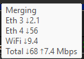
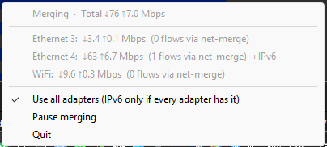

# net-merge

[](https://github.com/rohit267/net-merge/actions/workflows/ci.yml)
[](https://github.com/rohit267/net-merge/releases)
[](https://github.com/rohit267/net-merge/releases)
[](LICENSE)

[](https://buymeacoffee.com/rohit267)

**Use all your internet connections at the same time.**

Do you have Wi-Fi and a phone hotspot? Or Wi-Fi and an Ethernet cable? net-merge uses them all together,
so downloads, games and browsers get the speed of every connection added up. It works on **Windows,
macOS and Linux**. It is free. There is no account, no server and no VPN.

A real test with Wi-Fi + an Android USB tether + an iPhone hotspot, 9 downloads at once:
**232-303 Mbit/s**. The fastest connection alone gave about 121 Mbit/s.

| Hover the tray icon | Right-click the tray icon |
|---|---|
|  |  |

## How it helps

net-merge gives every new connection to one of your links. When an app opens many connections, they
spread over all your links.

- **Good for:** Steam and game downloads, browsers, system updates, cloud uploads (Google Drive),
  download managers like IDM, torrents.
- **Not for:** one single connection. One connection always uses one link, so one big file from one
  connection does not get faster.
- **Works for every app**, TCP and UDP, IPv4 and IPv6. You do not set up a proxy.
- **Smart:** faster links get more connections. A link with no internet gets none until it works again.
- **Safe:** if net-merge crashes, your internet keeps working.
- **Light:** about 0.18 CPU cores per 100 Mbit/s.

## Install

### Windows

1. Download `net-merge-setup-x.y.z.exe` from the [releases page](../../releases) and run it. It needs admin.
2. Windows may warn you because the app is not signed yet. Click *More info*, then *Run anyway*.
3. Open **net-merge** from the Start menu. A tray icon appears. If you do not see it, it is behind the
   `^` arrow next to the clock.

There is also a portable zip on the releases page.

### macOS (Apple Silicon and Intel)

1. Download `net-merge-x.y.z-macos-universal.tar.gz` from the [releases page](../../releases).
2. Open Terminal in that folder and run:

```
tar xzf net-merge-*-macos-universal.tar.gz
xattr -d com.apple.quarantine net-merge     # only if macOS says it can't open it
sudo ./net-merge install                    # once: lets the tray start without a password
net-merge tray                              # a green/grey icon appears in the menu bar
```

3. Optional: `net-merge autostart on` to start it when you log in.

`install` adds one small rule so that only `net-merge tray` can run as root without a password. To remove
it all: `net-merge autostart off` and `sudo net-merge uninstall`.

### Linux

1. Download `net-merge-x.y.z-linux-x86_64.tar.gz` (or `-linux-aarch64.tar.gz` for ARM) from the
   [releases page](../../releases).
2. Run:

```
tar xzf net-merge-*-linux-*.tar.gz
sudo install -m 755 net-merge /usr/local/bin/
sudo setcap cap_net_admin,cap_net_raw+ep /usr/local/bin/net-merge
net-merge tray
```

The `setcap` line lets net-merge work without root. The tray icon needs a desktop that supports
StatusNotifierItem: KDE, XFCE, Cinnamon, LXQt, Budgie, or GNOME with the *AppIndicator and
KStatusNotifierItem Support* extension. If your firewall blocks unknown traffic, trust the `net-merge`
interface (for example `firewall-cmd --zone=trusted --add-interface=net-merge`).

### NixOS

```nix
# flake.nix
inputs.net-merge.url = "github:rohit267/net-merge";

# configuration.nix (with `inputs` passed via specialArgs)
imports = [ inputs.net-merge.nixosModules.default ];
programs.net-merge = {
  enable = true;
  autostart = true;   # optional: start the tray in every graphical session
};
```

To try it without installing: `sudo nix run github:rohit267/net-merge -- run`.

## Add a second connection

net-merge needs **two or more** real connections. Use Wi-Fi plus one of these: a phone (USB tethering or
hotspot), an Ethernet cable, or a second Wi-Fi. Plug it in and net-merge adds it within a few seconds.
When you unplug it, its connections move to the others.

**Windows and Linux:** plug the phone in and turn on *USB tethering* (Android) or *Personal Hotspot*
(iPhone). That is all.

**Mac with an iPhone** (nothing extra to install)
1. Plug the iPhone in with a cable. Tap *Trust* on the iPhone if it asks.
2. On the iPhone, open *Settings > Personal Hotspot* and turn on *Allow Others to Join*.
3. An **iPhone USB** network appears on the Mac. net-merge adds it in a few seconds.

**Mac with an Android phone** (needs the app **TetherKit**)

macOS cannot use Android USB tethering by itself. The app **TetherKit** adds that support.
1. Install and open TetherKit.
2. Plug the phone in and turn on *USB tethering* in the phone's settings.
3. Click **Apply** in TetherKit. net-merge adds the new network in a few seconds.

> **Start net-merge first, then connect the Android phone.** macOS drops the TetherKit connection each
> time net-merge starts, quits, or is paused and resumed. If the phone link disappears, click **Apply**
> in TetherKit again. The iPhone is not affected.

A phone uses its mobile data, so part of your traffic goes through it while net-merge runs. Quit
net-merge when you do not want that.

## Use it

1. Start net-merge. A tray icon appears (menu bar on Mac).
2. The icon is **green** when it is merging and **grey** when it is paused.
3. **Hover** the icon to see the speed of each connection and the total.
4. **Right-click** the icon (on Mac, click it) to open the menu. It shows each connection's speed, how
   many connections net-merge gave it, and the buttons *Pause merging* / *Start merging* and *Quit*.
5. To start it at sign-in: tick the box in the Windows installer, or run `net-merge autostart on`.

Tips:
- Torrent clients already use every connection. Leave qBittorrent's network interface on *Any interface*.
- Leave *Use all adapters (IPv6 only if every adapter has it)* ticked. Untick it only if you must reach a
  site that only has IPv6.
- `net-merge list` shows which connections are used and why others are skipped. `net-merge status`
  shows live numbers.

## Commands

```
net-merge tray            tray icon (the normal way to run it)
net-merge on | off        start / pause merging in the running tray
net-merge quit            pause and close the tray
net-merge status | list   live numbers / which connections are used
net-merge autostart on|off|status
net-merge socks           plain SOCKS5 proxy on 127.0.0.1:1080 (no admin, per app)
net-merge cleanup         remove leftover routes after a crash
net-merge install         macOS only: `sudo net-merge install` (see above)
```

More flags and details are in [docs/DEVELOPING.md](docs/DEVELOPING.md).

## Good to know

- Needs admin (Windows), `CAP_NET_ADMIN` (Linux) or `sudo net-merge install` once (macOS).
- Some sites tie your login to one IP. net-merge may use a different IP for each connection, so such a
  site can ask you to log in again.
- If your connections differ in IPv6 support, sites that only have IPv6 are not reachable while the box
  above is ticked.

## More

- What changed in each version: [CHANGELOG.md](CHANGELOG.md)
- How it works, building from source, tests: [docs/DEVELOPING.md](docs/DEVELOPING.md)
- License: MIT, see `LICENSE`. Third-party parts: `THIRD-PARTY-NOTICES.md`.

## Support

net-merge is free. If it saves you time, you can [buy me a coffee](https://buymeacoffee.com/rohit267). Thank you!
